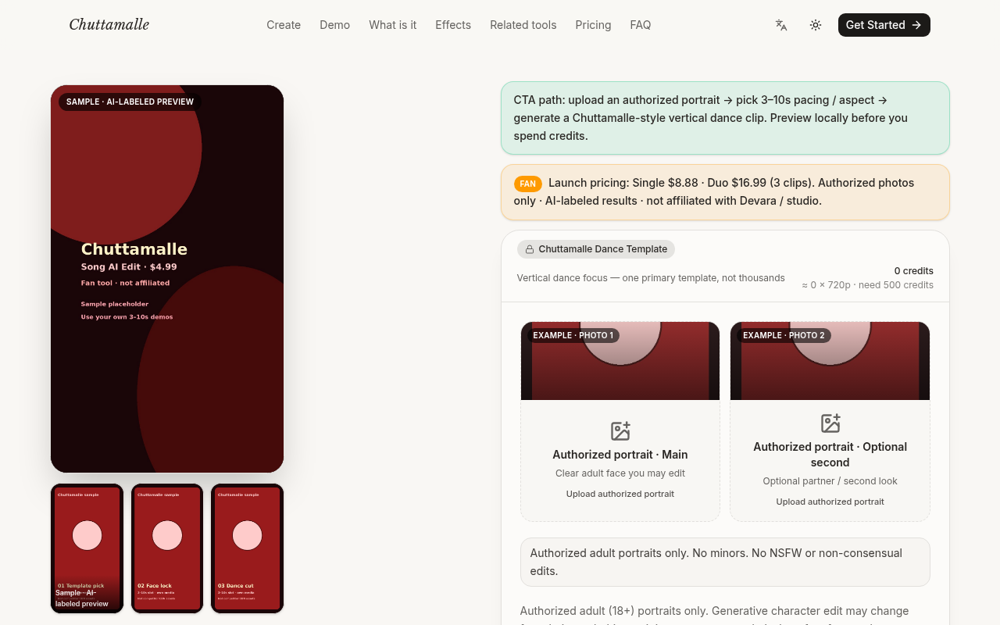
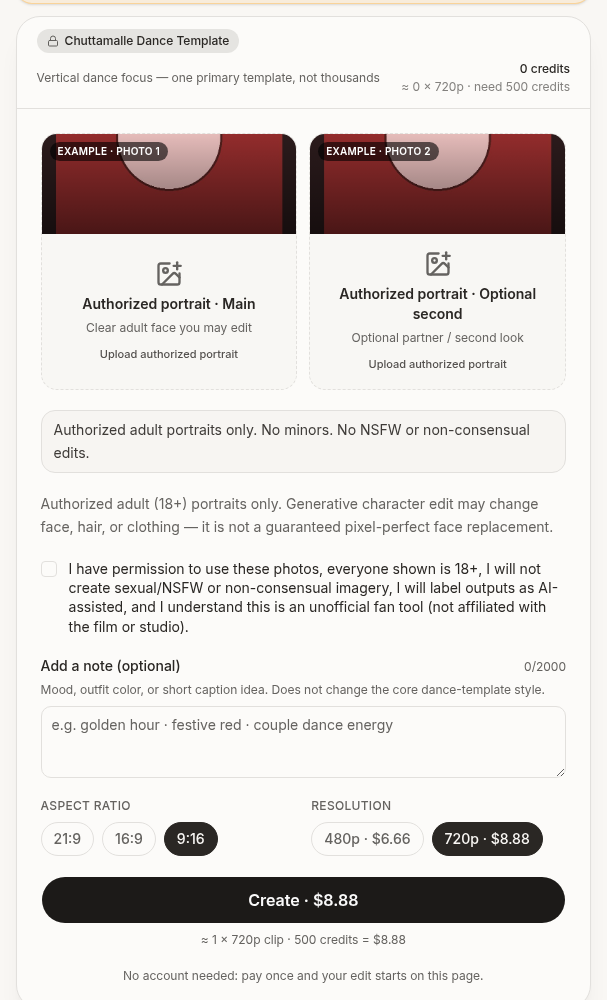
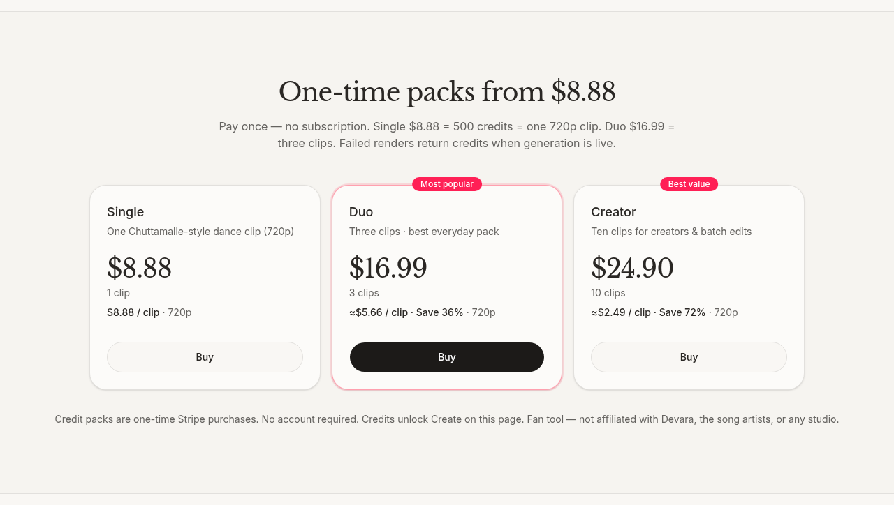

# Chuttamalle Dance AI

  

  <strong>授权肖像 → Chuttamalle 风格竖屏舞蹈短片（生成式人物编辑）</strong> 
  付费成片约 ~10s+ · 竖屏友好 · 游客可付 
  起价 <b>$8.88</b> · 无订阅、无需注册

> **Note:** Checkout may be limited — confirm on the live site before purchasing.

  
  

---

## 截图

  
  

---

## 怎么用

1. 打开 [trychuttamalle.app](https://trychuttamalle.app)
2. 上传一张你有权使用的成年人肖像（可选第二张）
3. 勾选完整授权声明 → 选画幅 / 分辨率 → Create
4. 设计为 Stripe 积分包：Single **$8.88** / 3-pack **$16.99** / 10-pack **$24.90** — **结账是否开放以下单页提示为准**

---

## 产品要点

- **不是专门换脸产品**：生成式人物编辑，可能改变面部/发型/服装
- 聚焦单一竖屏舞蹈模板；主打 9:16
- 原创 / AI 或授权音乐，不提供电影原声
- 早期试用站；示例可能为占位，支付与生成开放状态以官网为准

---

## 定价

| 套餐 | 价格 | 积分 |
|---|---|---|
| Single | $8.88 | 500 ≈ 1×720p |
| 3-pack | $16.99 | 1500 ≈ 3×720p |
| 10-pack | $24.90 | 5000 ≈ 10×720p |

一次性积分包，无订阅。英文简介：*Authorized portrait → Chuttamalle-style vertical dance short via generative character editing.*

---

## Links

- 官网：https://trychuttamalle.app
- GitHub Pages：https://xianyu110.github.io/chuttamalle-dance/
- 仓库：https://github.com/xianyu110/chuttamalle-dance

---

## License

Demo media for product showcase. Site © Maynor / xianyu110. Please only upload photos you own or have permission to use. Fan tool — unaffiliated with original artists, labels, or rights holders.
